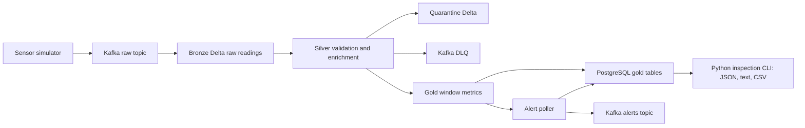

# VayuStream air-quality streaming pipeline

Build a local Python, Kafka, PySpark Structured Streaming, Delta Lake, and PostgreSQL pipeline with an inspection CLI for indicative real-time city AQI. Scope is Python, data engineering, backend interfaces, and DevOps only; no student-built frontend, including optional work.

## Quick facts

| Item | Value |
|---|---|
| Track | Data Engineering — Streaming and Big Data |
| Difficulty | ★★★★★ Advanced |
| Duration | 6 weeks, about 180 hours |
| Target job roles | Data Engineer, PySpark Developer, Spark / Databricks Engineer |
| Key skills | Python CLI, Kafka, PySpark, Structured Streaming, Delta Lake, PostgreSQL, data quality, local reliability |
| Prerequisites | Basic Python, SQL, Git, Linux commands, and Docker basics |
| Minimum hardware | 8 GB RAM lite profile; 16 GB RAM recommended |
| Student repository name | `vayustream` |

## What you will build

- A deterministic, internet-free sensor simulator for 10 stations in 5 Indian cities; Open-Meteo is separately opt-in.
- Kafka topics for raw readings, invalid readings, and alert events.
- A Bronze Delta table that preserves raw Kafka payloads and metadata.
- A Silver layer that validates, deduplicates, watermarks, and enriches readings.
- Gold 15-minute station and city windows with completeness percentages.
- Indicative CPCB AQI calculation for city windows.
- PostgreSQL gold tables with idempotent upserts.
- Stable alerts for Poor or worse AQI with a 60-minute cooldown.
- A Python inspection CLI for current AQI, recent windows, completeness, and alerts in JSON/text/CSV.
- A runbook for restart, replay from Kafka offsets, and Bronze-to-Silver reprocessing.

## Architecture at a glance

## How to read this specification

Read the documents in order from 01 to 14. Start with scope and users. Then read requirements, architecture, data model, pipeline behavior, tests, setup, and evaluation.

[Document 06](docs/06-tech-stack-and-setup.md) defines commands students MUST implement: `uv run --no-sync vayustream local start --profile lite` and `uv run --no-sync vayustream local stop`, initialization, loopback ports, offline demonstration, persistence, and confirmed reset. This repository contains specifications, not a running application. Kafka/Grafana built-in consoles MAY be inspected separately for operations, never implemented as a business interface or required for grading; lite starts no UI services.

The keywords MUST, SHOULD, and MAY follow RFC 2119. MUST means mandatory for grading. SHOULD means recommended after Must scope works. MAY means optional.

IDs are traceability anchors. User stories use `US-NN`. Functional requirements use `FR-AREA-NN`. Business rules use `BR-NN`. Non-functional requirements use `NFR-CAT-NN`. Test cases use `TC-TYPE-NNN`. Architecture decisions use `ADR-NNN` in the student repository.

## Document index

| Document | Purpose |
|---|---|
| [01 Project overview](docs/01-project-overview.md) | Business context, goals, scope, constraints, and success criteria. |
| [02 Users and roles](docs/02-users-and-roles.md) | Personas, permissions, journeys, and user stories. |
| [03 Functional requirements](docs/03-functional-requirements.md) | FRs, business rules, acceptance criteria, and validation rules. |
| [04 Non-functional requirements](docs/04-non-functional-requirements.md) | Performance, reliability, security, observability, portability, and quality targets. |
| [05 System architecture](docs/05-system-architecture.md) | Components, flows, deployment view, repository tree, and ADR list. |
| [06 Tech stack and setup](docs/06-tech-stack-and-setup.md) | Approved versions, setup, hardware profiles, and learning order. |
| [07 Data model](docs/07-data-model.md) | Data contracts, entities, Delta layers, PostgreSQL tables, and retention. |
| [08 Pipeline specification](docs/08-pipeline-specification.md) | Streaming jobs, topics, schedules, SLAs, checkpoints, and failure handling. |
| [09 Testing strategy](docs/09-testing-strategy-and-test-cases.md) | Test strategy, test cases, traceability, performance tests, and defect rules. |
| [10 DevOps, CI/CD, and quality](docs/10-devops-ci-cd-and-quality.md) | Git workflow, CI pipeline, Compose, environment variables, and Definition of Done. |
| [11 Milestones and deliverables](docs/11-milestones-and-deliverables.md) | 6-week plan, Gantt chart, submission process, and demo script. |
| [12 Evaluation rubric](docs/12-evaluation-rubric.md) | Mandatory gates, scoring, bonus rules, deductions, and viva questions. |
| [13 Interview preparation](docs/13-interview-preparation.md) | STAR pitch, interview questions, fundamentals, resume bullets, and mock checklist. |
| [14 Glossary and resources](docs/14-glossary-and-resources.md) | Definitions, official documentation links, and learning resources. |

## Rules for students

### Individual work

You MUST implement VayuStream alone in your own public repository. You MAY discuss concepts with classmates, but you MUST NOT copy code, tests, CLI contracts, or documentation from another student.

### AI assistant policy

> You MAY use AI assistants (for example GitHub Copilot or ChatGPT) to learn concepts, explain errors, and review your code. You MUST understand every line that you commit. You MUST tell the trainer about significant AI help in the pull request description. You MUST NOT give this specification to an AI tool and submit the generated solution as your own work. In the viva, the trainer asks you to explain and change your code live. If you cannot explain your code, the result is "Rework required".

### How to ask questions

> Open a GitHub Issue in this specification repository. Start the title with `[Question]`. The trainer answers in the issue, so all students can see the answer. If the answer changes the specification, the trainer updates the change log.

### Student repository

> Create a public repository with the name `vayustream` in your own GitHub account. Add the trainer (`@sukurcf`) as a collaborator. Do not copy this specification into your repository. Link to it from your README.

### Review model

> Every change goes through a pull request. You MAY merge your own pull request after CI is green and you complete the PR checklist. The trainer reviews at least 2 substantive pull requests from each student every week. The trainer can ask for changes at any time.

### Requirement freeze

> This specification is frozen for the cohort. The trainer can add clarifications. If a change affects grading, the change log states the impact.

### Weekly demo

Every Friday, you MUST give a 15-minute demo to the trainer. Show one working increment, one test result, and one issue or ADR.

## Change log

| Version | Date | Change |
|---|---|---|
| 1.0 | 2026-10-02 | First release |
| 1.1 | 2026-10-02 | Backend/data/DevOps-only revision. Frontend and cloud-deployment work is removed; its effort and points move to Python JSON/text/CSV inspection, offline local acceptance, persistence, and recovery evidence. Six weeks, 100-point weights, and minimum 45 tests remain unchanged; lite uses one broker, one shared Spark driver, 10 stations, and no UI services. |
