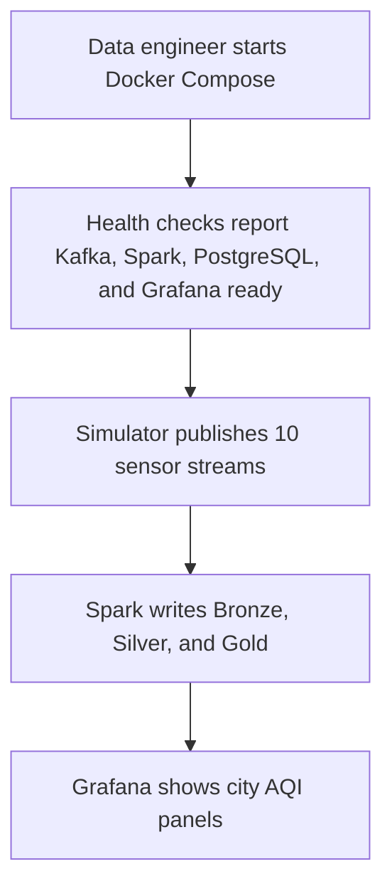
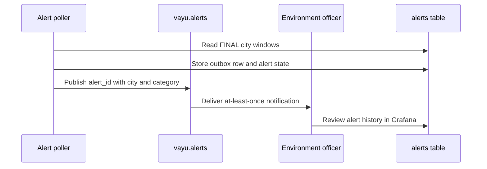
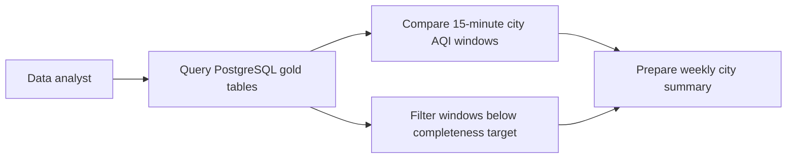

# Users and roles

Purpose: This document defines VayuStream users, permissions, journeys, and user stories.

## Roles

| Role | Type | Main responsibility |
|---|---|---|
| Data engineer | Human | Builds, runs, monitors, and repairs the streaming pipeline. |
| Environment officer | Human | Watches city AQI and responds to alert events. |
| Data analyst | Human | Uses historical gold tables for weekly air-quality summaries. |
| Sensor simulator | System | Publishes station readings to Kafka. |
| Alerting consumer | System | Consumes stable alert events and sends notifications. |
| Trainer | Human | Reviews demos, pull requests, tests, and viva explanations. |

## Personas

| Persona | Role | Goals | Pain points | Technical comfort |
|---|---|---|---|---|
| Aditi Nair | Data engineer | Prove she can run Kafka and Spark locally. | Late events and replays can create confusing duplicates. | High for Python and SQL, new to Spark internals. |
| Rakesh Kumar | Environment officer | See whether a city has Poor air quality now. | Daily reports arrive too late for operational action. | Medium for dashboards, low for code. |
| Farah Siddiqui | Data analyst | Compare city trends across weeks. | Raw sensor files contain gaps and invalid values. | High for SQL, medium for notebooks. |
| Pranav Menon | Trainer | Evaluate implementation quality fairly. | Generic demos hide weak streaming knowledge. | High for architecture and code review. |

## Permission matrix

| Action | Data engineer | Environment officer | Data analyst | Sensor simulator | Alerting consumer | Trainer |
|---|---|---|---|---|---|---|
| Configure simulator profile | Yes | No | No | No | No | Review |
| Publish raw readings | Operate | No | No | Yes | No | Review |
| View Kafka UI | Yes | No | No | No | No | Review |
| Inspect quarantine records | Yes | No | Read | No | No | Review |
| Query gold tables | Yes | Read | Read | No | No | Review |
| View Grafana dashboard | Yes | Yes | Read | No | No | Review |
| Receive alert notifications | No | Yes | No | No | Yes | Review |
| Restart streaming query | Yes | No | No | No | No | Review |
| Run tests and coverage | Yes | No | No | No | No | Review |
| Approve final demo | No | No | No | No | No | Yes |

## Key user journeys

### Journey 1: operate the lite pipeline

### Journey 2: respond to unhealthy air

### Journey 3: analyse history

## User stories

| ID | User story | Linked FR IDs |
|---|---|---|
| US-01 | As a data engineer, I want a deterministic lite simulator, so that I can test streaming without hardware. | FR-SIM-01, FR-SIM-02, FR-SIM-03 |
| US-02 | As a data engineer, I want Kafka topics with clear keys and retention, so that I can replay and debug messages. | FR-KAF-01, FR-KAF-02 |
| US-03 | As a data engineer, I want Bronze audit storage, so that I can trace every consumed raw event. | FR-BRZ-01 |
| US-04 | As a data engineer, I want Silver validation and enrichment, so that downstream tables use trusted station data. | FR-SLV-01, FR-SLV-02, FR-SLV-03, FR-SLV-04 |
| US-05 | As an environment officer, I want current city AQI, so that I can act on unhealthy air quality. | FR-GLD-01, FR-AQI-01, FR-DASH-01 |
| US-06 | As an environment officer, I want stable alerts, so that repeated delivery does not create duplicate incidents. | FR-ALT-01, FR-ALT-02 |
| US-07 | As a data analyst, I want station and city window tables, so that I can compare pollution patterns. | FR-GLD-01, FR-GLD-02 |
| US-08 | As a data engineer, I want restart-safe streams, so that recovery does not lose data or duplicate rows. | FR-OPS-01, FR-OPS-02 |
| US-09 | As a data engineer, I want a runbook, so that I can replay from Kafka offsets and reprocess data layers. | FR-OPS-03 |
| US-10 | As a data analyst, I want Open-Meteo mode, so that I can compare synthetic and external data. | FR-REAL-01 |
| US-11 | As an environment officer, I want richer Grafana panels, so that I can see pollutant drivers and completeness. | FR-DASH-02 |
| US-12 | As a data engineer, I want optional daily official-style AQI, so that I can compare it with indicative windows. | FR-DAILY-01 |
| US-13 | As a data engineer, I want optional maintenance tasks, so that Delta files stay queryable over time. | FR-MAINT-01 |
| US-14 | As a trainer, I want testable requirements, so that I can grade the streaming implementation consistently. | FR-TEST-01 |

## Story coverage for Must FRs

Every Must FR appears in at least one story from US-01 through US-09 and US-14. Should FRs appear in US-10 through US-13.

[Back to README](../README.md)
