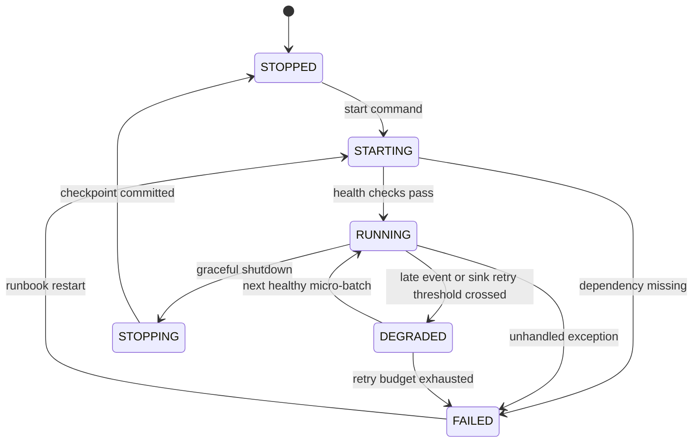
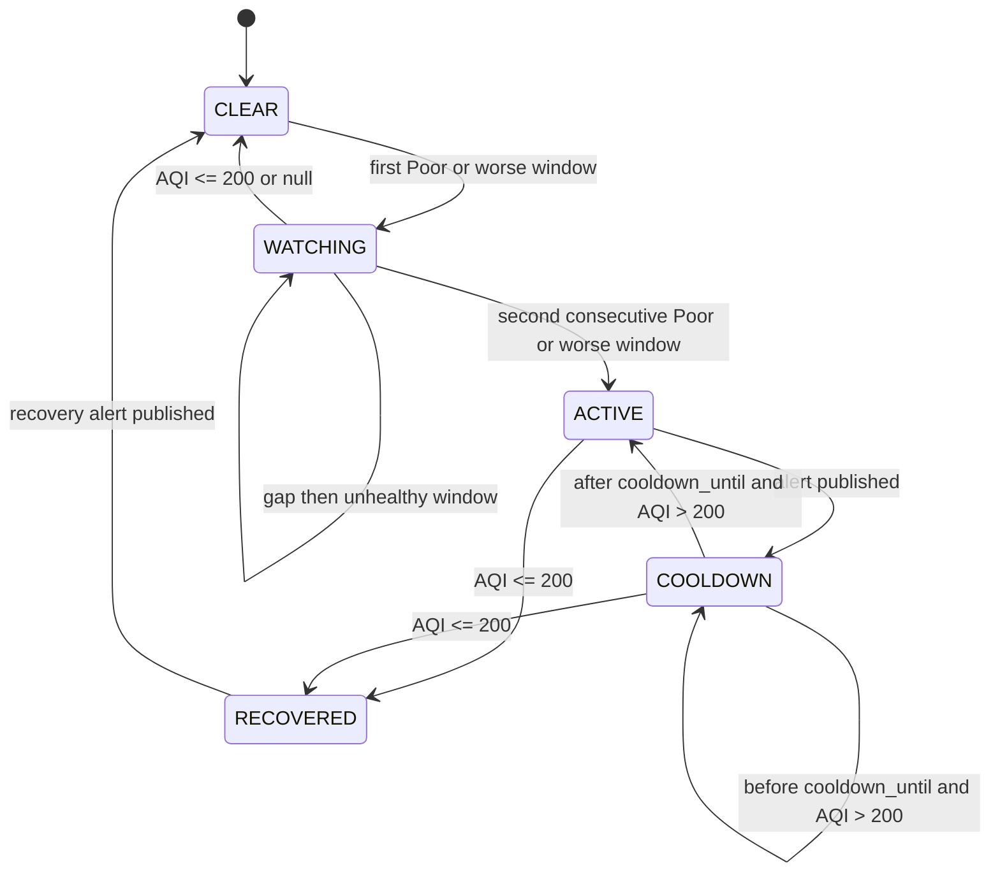

# Functional requirements

Purpose: This document defines VayuStream behavior with traceable functional requirements, business rules, states, validations, and errors.

## Functional requirement summary

| ID | Title | Priority | Roles | Linked BRs |
|---|---|---|---|---|
| FR-SIM-01 | Lite simulator station network | Must | Data engineer, Sensor simulator | BR-01, BR-02 |
| FR-SIM-02 | Deterministic fault injection | Must | Data engineer, Sensor simulator | BR-03, BR-04 |
| FR-SIM-03 | Producer contract and shutdown | Must | Data engineer, Sensor simulator | BR-05, BR-06 |
| FR-KAF-01 | Kafka local topics | Must | Data engineer | BR-07 |
| FR-KAF-02 | At-least-once message delivery | Must | Data engineer, Alerting consumer | BR-08 |
| FR-BRZ-01 | Bronze raw Delta table | Must | Data engineer | BR-09 |
| FR-SLV-01 | Parse and validate readings | Must | Data engineer | BR-10, BR-11 |
| FR-SLV-02 | DLQ and quarantine invalid events | Must | Data engineer | BR-12 |
| FR-SLV-03 | Deduplicate and watermark valid events | Must | Data engineer | BR-13 |
| FR-SLV-04 | Enrich readings with station reference | Must | Data engineer | BR-14 |
| FR-GLD-01 | Station and city 15-minute windows | Must | Data engineer, Data analyst | BR-15, BR-16 |
| FR-AQI-01 | Indicative CPCB AQI calculation | Must | Environment officer, Data analyst | BR-17, BR-18 |
| FR-GLD-02 | PostgreSQL idempotent gold upserts | Must | Data engineer, Data analyst | BR-19 |
| FR-ALT-01 | Alert creation and cooldown | Must | Environment officer, Alerting consumer | BR-20, BR-21 |
| FR-ALT-02 | Recovery alert | Must | Environment officer, Alerting consumer | BR-22 |
| FR-DASH-01 | Minimum Grafana dashboard | Must | Environment officer, Data analyst | BR-23 |
| FR-OPS-01 | Checkpoints and restart safety | Must | Data engineer | BR-24 |
| FR-OPS-02 | Health checks and one-command start | Must | Data engineer | BR-25 |
| FR-OPS-03 | Runbook operations | Must | Data engineer | BR-26 |
| FR-TEST-01 | Required deterministic tests | Must | Trainer, Data engineer | BR-27 |
| FR-REAL-01 | Open-Meteo real-data mode | Should | Data analyst, Data engineer | BR-28 |
| FR-DASH-02 | Extended dashboard panels | Should | Environment officer | BR-29 |
| FR-DAILY-01 | Daily official-style AQI batch | Should | Data analyst | BR-30 |
| FR-MAINT-01 | Delta maintenance and Kafka UI | Should | Data engineer | BR-31 |
| FR-STR-01 | Optional advanced storage and schema features | Could | Data engineer | BR-32 |

## Must requirements

### FR-SIM-01 Lite simulator station network

Description: The simulator MUST publish readings for 10 sensors in 5 Indian cities. It MUST read station reference data with station ID, city, state, latitude, longitude, and installed date. Each active sensor MUST publish one reading every 5 seconds unless the configured profile changes the interval.

Priority: Must. Roles: Data engineer, Sensor simulator. Linked BR IDs: BR-01, BR-02.

Acceptance criteria:
- Given the lite profile is selected, when the simulator runs for 60 seconds, then each of 10 station IDs publishes 12 readings with pollutants `pm25_ugm3`, `pm10_ugm3`, and `no2_ugm3`.
- Given station reference has 9 rows, when lite mode starts, then startup fails with error code `station-count-invalid`.
- Given a station has latitude 91.0, when the simulator loads the CSV, then it rejects that station with error code `station-location-out-of-range`.

### FR-SIM-02 Deterministic fault injection

Description: The simulator MUST include a fixed seeded fault scenario. The scenario MUST include extra duplicate copies, malformed JSON, out-of-range values, missing fields, and late events. Test runs MUST be reproducible with the same seed.

Priority: Must. Roles: Data engineer, Sensor simulator. Linked BR IDs: BR-03, BR-04.

Acceptance criteria:
- Given seed `vayu-lite-001`, when the deterministic test runs, then it emits 5 extra duplicate copies, 3 malformed payloads, and 2 events that arrive later than the active watermark.
- Given the seed is repeated, when the simulator emits the same 100-message schedule twice, then event IDs and timestamps are identical.
- Given a fault type is unknown, when configuration contains `fault_type=spike_magic`, then startup fails with error code `fault-type-unsupported`.

### FR-SIM-03 Producer contract and shutdown

Description: The producer MUST use station ID as the Kafka key. It MUST include `event_id`, `event_time`, `ingest_time`, pollutant values, units, and `source`. It MUST flush pending records during graceful shutdown.

Priority: Must. Roles: Data engineer, Sensor simulator. Linked BR IDs: BR-05, BR-06.

Acceptance criteria:
- Given a valid station reading, when it is published to `vayu.readings.raw`, then the Kafka key equals `station_id` and `event_id` is stable across retries.
- Given SIGTERM is sent during publishing, when shutdown completes within 10 seconds, then all acknowledged producer records are flushed or logged with `delivery-failed`.
- Given `pm25_ugm3` is missing, when the event is serialized, then the producer marks it as a configured missing-field fault, not as a valid reading.

### FR-KAF-01 Kafka local topics

Description: The local Kafka cluster MUST use Apache Kafka 4.x in KRaft mode with one broker. It MUST define topics `vayu.readings.raw`, `vayu.readings.dlq`, and `vayu.alerts`. Topic partition and retention settings MUST be documented in the pipeline specification.

Priority: Must. Primary role: data engineer. Linked BR IDs: BR-07.

Acceptance criteria:
- Given the stack starts, when topics are listed, then all 3 VayuStream topics exist before the simulator publishes.
- Given raw topic retention is configured, when the runbook checks it, then it reports at least 7 days for `vayu.readings.raw`.
- Given a topic name is misspelled as `vayu.reading.raw`, when health checks run, then health status is `unhealthy` with code `topic-missing`.

### FR-KAF-02 At-least-once message delivery

Description: Kafka messages and alert notifications MUST be at-least-once. Stable IDs MUST let consumers deduplicate side effects. The specification MUST NOT claim exactly-once delivery for external notifications.

Priority: Must. Roles: Data engineer, Alerting consumer. Linked BR IDs: BR-08.

Acceptance criteria:
- Given a producer retry occurs after a transient Kafka error, when the same event is sent again, then it uses the same `event_id` and station key.
- Given an alert notification is delivered twice, when the consumer stores by `alert_id`, then one incident record is visible.
- Given a document claims exactly-once webhook delivery, when the trainer reviews it, then the requirement fails.

### FR-BRZ-01 Bronze raw Delta table

Description: Bronze MUST append each consumed raw Kafka message with Kafka metadata. It MUST keep raw payload bytes or text, topic, partition, offset, key, Kafka timestamp, ingest time, and `ingest_date`. It MUST partition by `ingest_date`.

Priority: Must. Primary role: data engineer for audit storage. Linked BR IDs: BR-09.

Acceptance criteria:
- Given 100 raw Kafka messages are consumed, when Bronze finishes the micro-batch, then it contains 100 new rows with topic, partition, and offset.
- Given two messages have the same `event_id`, when Bronze writes them, then both raw messages remain for audit.
- Given `ingest_date` is missing from a Bronze row, when data quality checks run, then the check fails with code `bronze-partition-missing`.

### FR-SLV-01 Parse and validate readings

Description: Silver MUST parse JSON, cast types, and validate required fields. It MUST apply pollutant range checks. Only valid readings continue to Silver aggregation.

Priority: Must. Primary role: data engineer for validation. Linked BR IDs: BR-10, BR-11.

Acceptance criteria:
- Given a reading has `pm10_ugm3=85.2`, when Silver parses it, then the value is stored as decimal micrograms per cubic metre.
- Given a payload is malformed JSON, when Silver parses it, then no Silver row is created and reason `malformed-json` is recorded.
- Given `no2_ugm3=-1`, when validation runs, then the event is rejected with reason `pollutant-out-of-range`.

### FR-SLV-02 DLQ and quarantine invalid events

Description: Invalid events MUST be written to `vayu.readings.dlq` and to a quarantine table. Each record MUST include the original payload, reason code, ingest time, and optional station ID. The DLQ key SHOULD be station ID when it is parseable.

Priority: Must. Primary role: data engineer for rejection handling. Linked BR IDs: BR-12.

Acceptance criteria:
- Given 3 malformed JSON events in the deterministic test, when Silver runs, then 3 DLQ messages and 3 quarantine rows have reason `malformed-json`.
- Given a valid JSON payload misses `station_id`, when validation runs, then the DLQ key is `unknown` and reason is `required-field-missing`.
- Given a quarantine row lacks `reason_code`, when data quality checks run, then the check fails with code `quarantine-reason-required`.

### FR-SLV-03 Deduplicate and watermark valid events

Description: Silver MUST use `dropDuplicatesWithinWatermark` on `event_id`. The active cutoff is the maximum observed valid event time minus 15 minutes. It never decreases. It applies from the next micro-batch. Events at or before the active cutoff MUST be dropped from Silver and counted. Late dropped events MUST not create DLQ rows because their schema is valid.

Priority: Must. Primary role: data engineer for stream state. Linked BR IDs: BR-13.

Acceptance criteria:
- Given 5 duplicate copies arrive within the watermark, when Silver writes valid readings, then exactly 5 duplicate rows are excluded.
- Given 2 valid events at 10:00 arrive after the active cutoff reaches 10:16, when Silver processes them, then metric `late_events_dropped` increases by 2.
- Given a late event is valid JSON, when it is dropped by watermark, then no DLQ message is produced for that event.
- Given Spark reports dropped duplicates in query progress, when metrics are exported, then `duplicate_events_dropped` uses that state-operator metric.

### FR-SLV-04 Enrich readings with station reference

Description: Silver MUST enrich valid readings with station city, state, latitude, longitude, and installed date. The enrichment MUST be a stream-static join against the station reference dataset. Unknown station IDs MUST be rejected.

Priority: Must. Primary role: data engineer for station enrichment. Linked BR IDs: BR-14.

Acceptance criteria:
- Given `station_id=DEL-001` exists in station reference, when Silver writes the row, then it includes city `Delhi` and the configured latitude and longitude.
- Given `station_id=BAD-404`, when enrichment runs, then the event is quarantined with reason `station-not-found`.
- Given station reference contains duplicate `station_id`, when the stream starts, then startup fails with code `station-id-not-unique`.

### FR-GLD-01 Station and city 15-minute windows

Description: Gold MUST calculate tumbling 15-minute windows for each station and each city. It MUST calculate average, minimum, maximum, reading count, and completeness percentage for each pollutant. Completeness uses unique valid readings divided by expected readings.

Priority: Must. Roles: Data engineer, Data analyst. Linked BR IDs: BR-15, BR-16.

Acceptance criteria:
- Given one active station emits every 5 seconds for a full 15-minute window, when aggregation completes, then expected readings are 180 for that station.
- Given city Delhi has 2 active sensors, when a full window has 350 unique valid readings, then completeness is 350 ÷ 360 × 100 = 97.22% rounded to 2 decimals.
- Given a duplicate event reaches Gold input, when aggregation counts readings, then the duplicate does not increase `reading_count`.

### FR-AQI-01 Indicative CPCB AQI calculation

Description: The city AQI MUST use the CPCB National AQI sub-index method. It MUST use linear interpolation between official CPCB breakpoints. The 15-minute real-time value MUST be labelled indicative because official AQI uses longer averaging periods.

Priority: Must. Roles: Environment officer, Data analyst. Linked BR IDs: BR-17, BR-18.

Acceptance criteria:
- Given city averages PM2.5 95 µg/m³, PM10 260 µg/m³, and NO2 90 µg/m³, when AQI is calculated, then AQI is 215 and category is Poor.
- Given only NO2 and PM10 are valid for a city window, when AQI is calculated, then `aqi_value` is null because fewer than 3 pollutants are available.
- Given PM2.5, PM10, and NO2 are available and PM10 is missing, when PM2.5 and NO2 remain with no third pollutant, then `aqi_value` is null and not 0.
- Given an AQI panel title is rendered, when the value is from a 15-minute window, then the label includes `indicative`.

### FR-GLD-02 PostgreSQL idempotent gold upserts

Description: Gold city and station windows MUST be written to PostgreSQL in `foreachBatch`. Writes MUST be idempotent by business key. Gold MUST key rows by city or station and `window_start`. A FINAL write updates the existing row to FINAL. A later PROVISIONAL write MUST NOT overwrite a FINAL row.

Priority: Must. Roles: Data engineer, Data analyst. Linked BR IDs: BR-19.

Acceptance criteria:
- Given city `Delhi` and window start `2026-10-02T10:00:00Z`, when the same FINAL batch is replayed twice, then `gold.city_window_aqi` has one row for that key.
- Given station `DEL-001` and window start `2026-10-02T10:15:00Z` is FINAL, when an older PROVISIONAL replay occurs, then the FINAL row is not overwritten.
- Given an upsert misses `window_start`, when validation runs, then the sink rejects the row with code `gold-key-incomplete`.

### FR-ALT-01 Alert creation and cooldown

Description: A restartable Python alert poller MUST create an alert when FINAL city windows are Poor or worse for 2 consecutive 15-minute windows. It MUST poll every 30 seconds, read windows in event-time order, persist its cursor, and publish through an outbox row. Cooldown is 60 minutes for each city and category.

Priority: Must. Roles: Environment officer, Alerting consumer. Linked BR IDs: BR-20, BR-21.

Acceptance criteria:
- Given Delhi has category Poor in FINAL windows 10:00 and 10:15, when the poller reads the 10:15 window, then one alert with stable `alert_id` is published.
- Given Delhi Poor alert was created at 10:30:15, when Delhi remains Poor at 10:30 and 10:45, then no new Poor alert is created before 11:30:15.
- Given Delhi has one Poor window followed by Moderate, when the second window closes, then no Poor alert is created.

### FR-ALT-02 Recovery alert

Description: The system MUST create a recovery alert when a city with an active unhealthy alert returns to Moderate or better. Recovery threshold is AQI less than or equal to 200. Recovery alerts MUST also use stable IDs.

Priority: Must. Roles: Environment officer, Alerting consumer. Linked BR IDs: BR-22.

Acceptance criteria:
- Given Mumbai has an active Very Poor alert, when AQI becomes 200, then a recovery alert is created.
- Given Mumbai AQI becomes 201, when the window closes, then no recovery alert is created.
- Given a recovery event is delivered twice, when consumers deduplicate by `alert_id`, then one recovery incident is visible.

### FR-DASH-01 Minimum Grafana dashboard

Description: Grafana MUST use a provisioned PostgreSQL data source. The dashboard MUST have current AQI for each city with CPCB colours, AQI trend, and alerts table. It MUST show null AQI as insufficient data.

Priority: Must. Roles: Environment officer, Data analyst. Linked BR IDs: BR-23.

Acceptance criteria:
- Given city AQI is 250, when Grafana renders current AQI, then the city uses the Poor colour and label.
- Given `aqi_value` is null, when Grafana renders the panel, then the value text is `Insufficient data`.
- Given at least one alert exists, when the alerts table loads, then it shows `alert_id`, city, category, status, and created time.

### FR-OPS-01 Checkpoints and restart safety

Description: Every streaming query MUST have an isolated checkpoint directory. A restart MUST cause no data loss. Delta tables and PostgreSQL tables MUST avoid duplicates by idempotent writes and keys.

Priority: Must. Primary role: data engineer for recovery. Linked BR IDs: BR-24.

Acceptance criteria:
- Given the Silver query stops after processing offset 50, when it restarts, then it resumes from the checkpoint and does not skip offset 51.
- Given failure happens after PostgreSQL sink write and before checkpoint commit, when the batch replays, then gold row count remains unchanged.
- Given two queries share one checkpoint path, when health checks run, then status is `unhealthy` with code `checkpoint-not-isolated`.

### FR-OPS-02 Health checks and one-command start

Description: The student repository MUST provide one documented command that starts the lite stack. Health checks MUST verify Kafka, topics, Spark query status, PostgreSQL, and Grafana data source. Lite profile MUST fit 8 GB RAM.

Priority: Must. Primary role: data engineer for local operations. Linked BR IDs: BR-25.

Acceptance criteria:
- Given a clean clone on the lite reference laptop, when the documented start command runs, then health status becomes `healthy` within 5 minutes.
- Given Kafka is unavailable, when health checks run, then status is `unhealthy` and simulator does not start publishing.
- Given Kafka UI is enabled in lite mode, when profile validation runs, then it fails with code `lite-service-disabled`.

### FR-OPS-03 Runbook operations

Description: The runbook MUST explain restart, replay from Kafka offsets, and Bronze-to-Silver reprocessing. It MUST include safe warnings for at-least-once outputs and idempotent upserts. It MUST state when checkpoints may be reset.

Priority: Must. Primary role: data engineer for runbook use. Linked BR IDs: BR-26.

Acceptance criteria:
- Given the Silver query fails, when the runbook restart procedure is followed, then it preserves the existing checkpoint.
- Given a replay from raw offsets is requested, when the runbook is used, then it instructs the operator to verify idempotent sink keys first.
- Given an operator wants to delete a checkpoint during production-like demo, when the runbook is checked, then it marks this as unsafe unless the sink is rebuilt.

### FR-TEST-01 Required deterministic tests

Description: The implementation MUST include tests for event contracts, transformations, AQI boundaries, deterministic streaming, and restart recovery. AQI module branch coverage MUST be 100%. The full project MUST meet line coverage 80% and branch coverage 70%.

Priority: Must. Roles: Trainer, Data engineer. Linked BR IDs: BR-27.

Acceptance criteria:
- Given the deterministic 100-message test runs, when it finishes, then expected counts are Bronze 100, Silver 87, DLQ 6, quarantine 6, late dropped 2, and duplicate dropped 5.
- Given AQI boundary tests run, when each CPCB breakpoint edge is tested, then branch coverage for the AQI module is 100%.
- Given coverage is line 79.9%, when CI evaluates gates, then CI fails.

## Should and Could requirements

### FR-REAL-01 Open-Meteo real-data mode

Description: The system SHOULD poll the Open-Meteo Air Quality API once per hour for each configured city. It SHOULD publish events with `source=open-meteo` after confirming free, no-key, non-commercial API terms. It SHOULD convert units when the API differs from VayuStream units.

Priority: Should. Roles: Data analyst, Data engineer. Linked BR IDs: BR-28.

Acceptance criteria:
- Given Open-Meteo mode is enabled for 5 cities, when the hourly poll runs, then one batch per city is published with `source=open-meteo`.
- Given the API is unavailable, when the poll fails, then the system logs `open-meteo-unavailable` and does not stop simulator mode.

### FR-DASH-02 Extended dashboard panels

Description: The dashboard SHOULD add pollutant breakdown and station completeness panels. It SHOULD contain at least 5 Grafana panels in standard profile. It SHOULD keep the 3 Must panels unchanged.

Priority: Should. Roles: Environment officer. Linked BR IDs: BR-29.

Acceptance criteria:
- Given standard profile is enabled, when Grafana loads, then it shows at least 5 panels.
- Given a station has completeness 70%, when the completeness panel renders, then it highlights the station below the 90% review threshold.

### FR-DAILY-01 Daily official-style AQI batch

Description: The project SHOULD calculate daily city AQI into `gold.daily_city_aqi`. It SHOULD use 24-hour averages for PM2.5, PM10, NO2, SO2, and NH3. It SHOULD use maximum 8-hour averages for CO. For O3, it SHOULD use the VayuStream reading of the CPCB footnote in the pipeline specification.

Priority: Should. Roles: Data analyst. Linked BR IDs: BR-30.

Acceptance criteria:
- Given a complete day of city data, when the daily batch runs, then one row per city is written to `gold.daily_city_aqi`.
- Given CO is included, when daily AQI is calculated, then it uses the maximum 8-hour average for CO.

### FR-MAINT-01 Delta maintenance and Kafka UI

Description: The project SHOULD schedule Delta maintenance for OPTIMIZE-like compaction and VACUUM-like retention. It SHOULD expose Kafka UI in standard profile only. It SHOULD log streaming progress and consumer lag.

Priority: Should. Roles: Data engineer. Linked BR IDs: BR-31.

Acceptance criteria:
- Given standard profile is enabled, when services start, then Kafka UI is available and shows `vayu.readings.raw`.
- Given maintenance runs, when retention is checked, then it does not delete files needed by active checkpoints.

### FR-STR-01 Optional advanced storage and schema features

Description: The project COULD add Avro with an open-source schema registry. It COULD add maintained S3-compatible storage after an ADR verifies licence and maintenance status. It COULD add z-score sensor-drift detection and a Grafana Geomap.

Priority: Could. Roles: Data engineer. Linked BR IDs: BR-32.

Acceptance criteria:
- Given Avro mode is enabled, when an incompatible schema is published, then the producer rejects it before Kafka send.
- Given object storage is chosen, when the ADR is reviewed, then it explains current maintenance status and local cost.

## Business rules

| BR ID | Exact rule and values | Used by |
|---|---|---|
| BR-01 | Lite profile has exactly 10 sensors in 5 Indian cities. | FR-SIM-01 |
| BR-02 | Lite reading interval is 5 seconds per active sensor. | FR-SIM-01 |
| BR-03 | Deterministic test input has 100 raw messages: B1 has 97 records with 86 unique valid 10:00-10:15 readings, 5 extra duplicate copies, 3 malformed JSON payloads, 2 missing required fields, and 1 out-of-range pollutant value; B2 has 1 valid 10:31 reading; B3 has 2 new valid event IDs at 10:00 that arrive after the watermark is active. | FR-SIM-02, FR-TEST-01 |
| BR-04 | Duplicate, malformed, missing-field, out-of-range, and late-event faults MUST be reproducible from seed `vayu-lite-001`. | FR-SIM-02 |
| BR-05 | Kafka key MUST equal `station_id` for raw readings when station ID is parseable. | FR-SIM-03 |
| BR-06 | Graceful shutdown budget is 10 seconds. | FR-SIM-03 |
| BR-07 | Required topics are `vayu.readings.raw`, `vayu.readings.dlq`, and `vayu.alerts`; raw retention is at least 7 days. | FR-KAF-01 |
| BR-08 | External delivery is at-least-once with stable `event_id` or `alert_id`. | FR-KAF-02 |
| BR-09 | Bronze is append-only Delta partitioned by `ingest_date`. | FR-BRZ-01 |
| BR-10 | Required pollutants for Must scope are PM2.5, PM10, and NO2 in µg/m³. | FR-SLV-01 |
| BR-11 | Allowed Must pollutant ranges are 0 to 1000 µg/m³ for PM2.5, PM10, and NO2. | FR-SLV-01 |
| BR-12 | Invalid events are written to both `vayu.readings.dlq` and `quarantine.invalid_readings`. | FR-SLV-02 |
| BR-13 | Silver uses `dropDuplicatesWithinWatermark` on `event_id`; the active cutoff is maximum observed valid event time minus 15 minutes, never decreases, and drops events at or before the cutoff. | FR-SLV-03 |
| BR-14 | Station reference `station_id` is unique and required for enrichment. | FR-SLV-04 |
| BR-15 | Aggregation windows are tumbling 15-minute windows by station and by city. | FR-GLD-01 |
| BR-16 | Completeness % = unique valid readings ÷ expected readings × 100; expected = window length ÷ reading interval × active sensors. | FR-GLD-01 |
| BR-17 | AQI requires at least 3 pollutants and at least one of PM2.5 or PM10; otherwise AQI is null. | FR-AQI-01 |
| BR-18 | Indicative AQI = maximum pollutant sub-index from CPCB linear interpolation. | FR-AQI-01 |
| BR-19 | Gold PostgreSQL keys are city or station plus `window_start`; `window_status` is not part of the key. | FR-GLD-02 |
| BR-20 | Unhealthy alert threshold is Poor or worse, AQI 201 or more, for 2 consecutive 15-minute windows. | FR-ALT-01 |
| BR-21 | Alert cooldown is `created_at` plus 60 minutes for each city and AQI category; retries keep the original `created_at`. | FR-ALT-01 |
| BR-22 | Recovery alert threshold is AQI less than or equal to 200. | FR-ALT-02 |
| BR-23 | Must Grafana panels are current AQI, AQI trend, and alerts table. | FR-DASH-01 |
| BR-24 | Each streaming query has one isolated checkpoint directory. | FR-OPS-01 |
| BR-25 | Lite profile disables Kafka UI and uses Spark 2304 MiB with 1500m heap. | FR-OPS-02 |
| BR-26 | Runbook covers restart, Kafka offset replay, and Bronze-to-Silver reprocessing. | FR-OPS-03 |
| BR-27 | Coverage gates are line 80%, branch 70%, and AQI module branch 100%. | FR-TEST-01 |
| BR-28 | Open-Meteo mode polls once per hour for each city and uses `source=open-meteo`. | FR-REAL-01 |
| BR-29 | Standard Grafana dashboard has at least 5 panels. | FR-DASH-02 |
| BR-30 | Daily AQI uses 24-hour averages for PM2.5, PM10, NO2, SO2, and NH3; CO uses maximum 8-hour averages; O3 uses 8-hour values through 208 µg/m³ and 1-hour values above 208 µg/m³. | FR-DAILY-01 |
| BR-31 | Kafka UI and 50-sensor standard profile require 16 GB RAM. | FR-MAINT-01 |
| BR-32 | Could items require ADR approval before implementation. | FR-STR-01 |

## CPCB AQI method

Official source: CPCB, `How AQI Calculated.pdf`, <https://app.cpcbccr.com/ccr_docs/How_AQI_Calculated.pdf>, and CPCB AQI information page <https://cpcb.nic.in/air-quality-index/>.

Linear interpolation formula in plain text: sub_index = ((index_high - index_low) / (breakpoint_high - breakpoint_low)) * (concentration - breakpoint_low) + index_low.

VayuStream truncates window-average concentrations before band lookup. It truncates CO to 1 decimal mg/m³. It truncates other pollutants to whole µg/m³. It rounds sub-index values half up to an integer. Concentration 0 gives sub-index 0. The AQI is the maximum sub-index.

The official Severe band is open-ended. VayuStream continues the Very Poor slope and caps the sub-index at 500. This Severe cap is a project convention, not an official CPCB upper concentration.

The 15-minute VayuStream AQI is indicative. Official CPCB AQI uses 24-hour averages for PM2.5, PM10, NO2, SO2, and NH3. It uses 8-hour averages for CO and O3.

| Category | AQI range | PM2.5 | PM10 | NO2 | SO2 | CO | O3 | NH3 |
|---|---:|---:|---:|---:|---:|---:|---:|---:|
| Good | 0-50 | 0-30 | 0-50 | 0-40 | 0-40 | 0-1.0 | 0-50 | 0-200 |
| Satisfactory | 51-100 | 31-60 | 51-100 | 41-80 | 41-80 | 1.1-2.0 | 51-100 | 201-400 |
| Moderate | 101-200 | 61-90 | 101-250 | 81-180 | 81-380 | 2.1-10 | 101-168 | 401-800 |
| Poor | 201-300 | 91-120 | 251-350 | 181-280 | 381-800 | 10.1-17 | 169-208 | 801-1200 |
| Very Poor | 301-400 | 121-250 | 351-430 | 281-400 | 801-1600 | 17.1-34 | 209-748 | 1201-1800 |
| Severe | 401-500 | >250 | >430 | >400 | >1600 | >34 | >748 | >1800 |

Units are µg/m³ except CO, which uses mg/m³. Effective VayuStream Severe caps are PM2.5 380.3, PM10 509.8, NO2 520.2, SO2 2407.1, CO 51.1, O3 1292.4, and NH3 2405.1.

## State machines

### Streaming query state

| From | Event | Guard | To | Actor |
|---|---|---|---|---|
| STOPPED | start command | Kafka, PostgreSQL, and Delta paths configured | STARTING | Data engineer |
| STARTING | health checks pass | all required topics exist | RUNNING | Health check |
| STARTING | dependency missing | any required service unavailable | FAILED | Health check |
| RUNNING | metric warning | late events or sink retries exceed configured threshold | DEGRADED | Spark query |
| DEGRADED | healthy batch | next micro-batch writes all required sinks | RUNNING | Spark query |
| RUNNING | graceful shutdown | SIGTERM received | STOPPING | Data engineer |
| STOPPING | checkpoint committed | active batch completed | STOPPED | Spark query |
| RUNNING | unhandled exception | retry budget exhausted | FAILED | Spark query |
| FAILED | runbook restart | checkpoint preserved | STARTING | Data engineer |

### Alert lifecycle

| From | Event | Guard | To | Actor |
|---|---|---|---|---|
| CLEAR | final window read | category Poor, Very Poor, or Severe | WATCHING | Alert poller |
| WATCHING | next adjacent final window read | same city AQI > 200 | ACTIVE | Alert poller |
| WATCHING | non-adjacent final window read | category Poor, Very Poor, or Severe | WATCHING | Alert poller |
| WATCHING | next final window read | AQI <= 200 or null AQI | CLEAR | Alert poller |
| ACTIVE | alert written | `alert_id` stored in outbox | COOLDOWN | Alert poller |
| COOLDOWN | final window read | before `cooldown_until` and AQI > 200 | COOLDOWN | Alert poller |
| COOLDOWN | final window read | at or after `cooldown_until` and AQI > 200 | ACTIVE | Alert poller |
| ACTIVE | final window read | AQI <= 200 | RECOVERED | Alert poller |
| COOLDOWN | final window read | AQI <= 200 | RECOVERED | Alert poller |
| RECOVERED | recovery written | stable recovery `alert_id` stored in outbox | CLEAR | Alert poller |

## Validation rules

| Field | Rule | Error message or code |
|---|---|---|
| `event_id` | Required stable opaque string of 12 to 80 characters. | `required-field-missing` or `event-id-invalid` |
| `station_id` | Required string matching station reference. | `required-field-missing` or `station-not-found` |
| `event_time` | Required ISO-8601 timestamp with timezone. | `event-time-invalid` |
| `ingest_time` | Required ISO-8601 timestamp assigned before Kafka send. | `ingest-time-invalid` |
| `source` | Required enum: `simulator`, `open-meteo`. | `source-unsupported` |
| `profile` | Required enum: `lite`, `standard`, `real-data`. | `profile-unsupported` |
| `quality_flags` | Optional array of supported simulator flags. | `quality-flag-unsupported` |
| `pm25_ugm3` | Required decimal from 0 to 1000 in Must scope. | `pollutant-out-of-range` |
| `pm10_ugm3` | Required decimal from 0 to 1000 in Must scope. | `pollutant-out-of-range` |
| `no2_ugm3` | Required decimal from 0 to 1000 in Must scope. | `pollutant-out-of-range` |
| `schema_version` | Required string `1.0`. | `schema-version-unsupported` |
| station CSV `latitude` | Decimal between -90 and 90. | `station-location-out-of-range` |
| station CSV `longitude` | Decimal between -180 and 180. | `station-location-out-of-range` |
| `alert_id` | Required stable string for each city, category, window, and alert type. | `alert-id-invalid` |

## Error scenarios

| Condition | System response | User-visible message or status |
|---|---|---|
| Kafka broker unavailable at startup | Health check fails; simulator does not publish. | `unhealthy: kafka-unavailable` |
| Missing Kafka topic | Health check fails before processing. | `unhealthy: topic-missing` |
| Malformed JSON payload | Write original payload to DLQ and quarantine. | Quarantine reason `malformed-json` |
| Missing required field | Write payload to DLQ and quarantine. | Quarantine reason `required-field-missing` |
| Unknown station ID | Reject after station join. | Quarantine reason `station-not-found` |
| Duplicate event within watermark | Drop duplicate from Silver. | Metric `duplicate_events_dropped` increments. |
| Valid event at or before active watermark cutoff | Drop from Silver and count. | Metric `late_events_dropped` increments. |
| PostgreSQL unavailable | Retry batch; keep checkpoint uncommitted until sink succeeds or query fails. | Query state `DEGRADED` then `FAILED` if retries exhaust. |
| AQI lacks 3 pollutants | Store null AQI. | Dashboard text `Insufficient data` |
| Alert delivered twice | Consumer deduplicates by `alert_id`. | One incident remains visible. |

[Back to README](../README.md)
