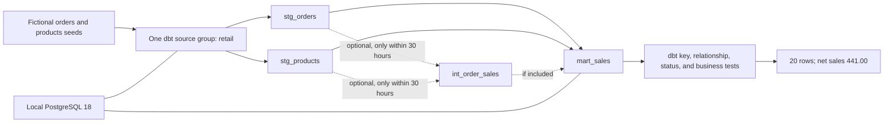

# System architecture

## Model flow

## Data flow

1. Docker Compose starts one local PostgreSQL database on `127.0.0.1:15433`.
2. `dbt seed` loads the fictional `orders` and `products` tables.
3. One dbt source group, `retail`, declares those input tables.
4. `stg_orders` and `stg_products` cast fields without changing their row grains.
5. `mart_sales` joins each order to one product and computes net sales.
6. dbt tests validate keys, product references, status values, and the business formula.

The required transformation path is SQL/dbt only. There is no service beyond local PostgreSQL and no browser or hosted documentation interface.

## Design questions

Record an ADR only if a decision changes the required contract:

| ID | Question |
|---|---|
| ADR-01 | How will local dbt seeds be exposed as the single `retail` source group in PostgreSQL? |
| ADR-02 | Which required models should be tables or views while keeping the demo repeatable with full refresh? |
| ADR-03 | If the optional intermediate model is attempted, how will a full-refresh baseline be preserved for comparison with one incremental experiment? |

[Back to README](../README.md)
