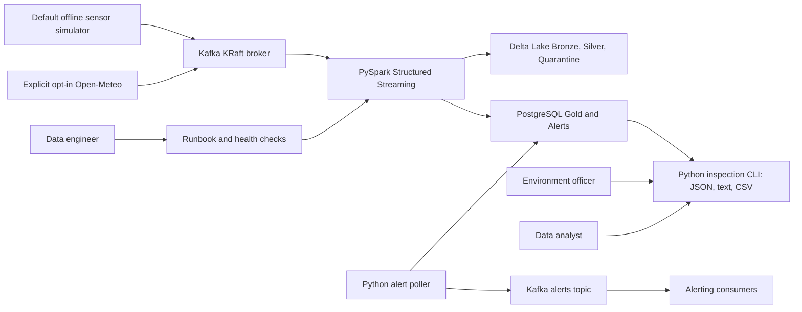
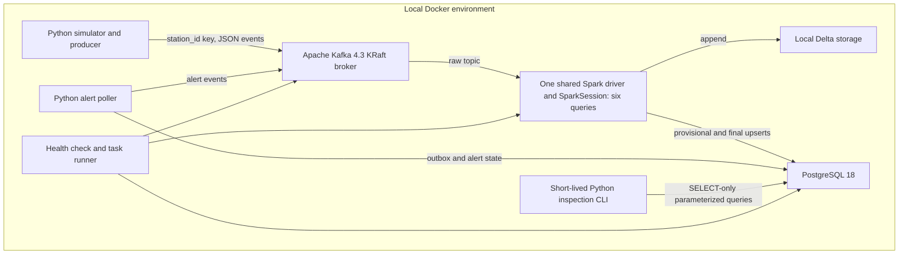
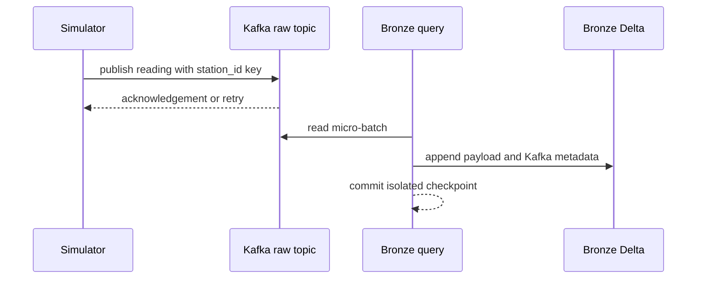
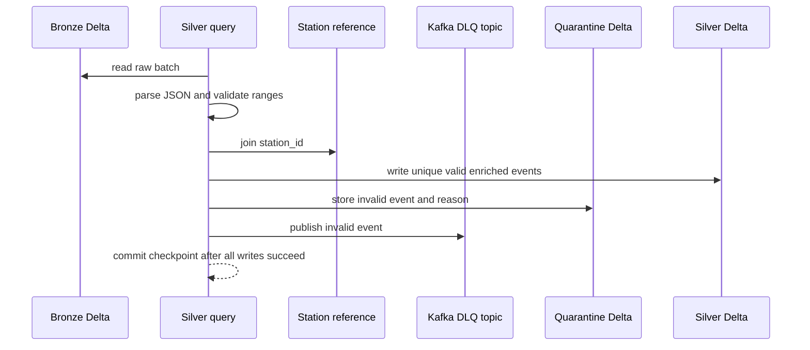
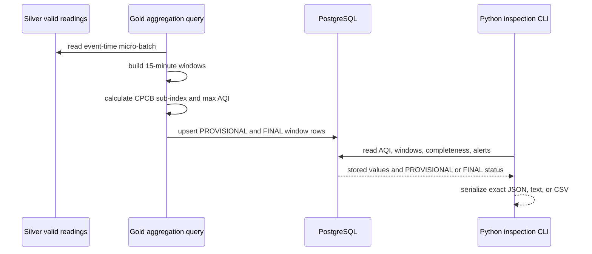
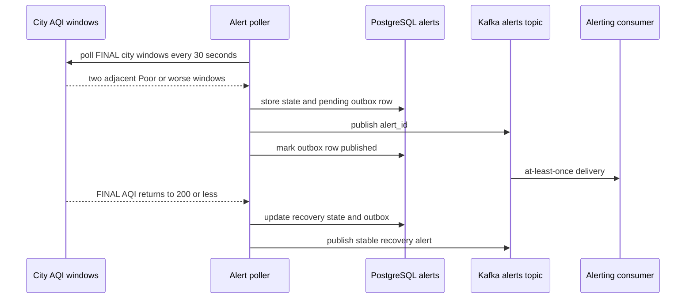
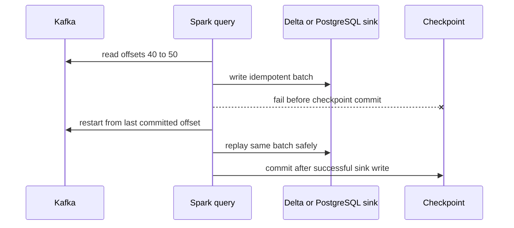

# System architecture

Purpose: This document explains the VayuStream architecture, main flows, local deployment, implementation repository shape, and required architecture decisions.

## Context diagram



The system runs locally without internet after initial downloads. Simulated stations are the default Must source; Open-Meteo is separately opt-in Should scope. No student frontend is implemented. Built-in Kafka/Grafana consoles may be inspected separately for operations only, never as business or grader evidence.

## Container and component diagram



## Key sequence flows

### Simulator to Bronze



### Silver validation and quarantine



### Gold AQI and Python inspection



### Alert and recovery flow



### Restart-safe replay



## Data-flow description

1. The simulator creates JSON readings for 10 lite stations in 5 cities.
2. The producer sends each parseable reading to `vayu.readings.raw` with key `station_id`.
3. Bronze stores every Kafka message with topic, partition, offset, key, timestamp, payload, and `ingest_date`.
4. Silver parses JSON, casts fields, validates ranges, joins station reference data, deduplicates by `event_id`, and applies a 15-minute watermark.
5. Invalid events go to both `vayu.readings.dlq` and `quarantine.invalid_readings`.
6. Valid late events are dropped from Silver and counted. They do not go to the DLQ.
7. Gold creates 15-minute station and city windows. It calculates completeness and indicative AQI.
8. Gold upserts PROVISIONAL rows in Update mode and FINAL rows in Append mode.
9. The alert poller reads FINAL city windows, writes outbox rows, and publishes at-least-once alert messages.
10. The Python inspection CLI reads PostgreSQL serving tables only. It does not read raw Kafka/Delta or recompute AQI, and keeps null AQI and PROVISIONAL/FINAL status explicit.

## Local deployment view

| Profile | Laptop | Services | Proposed limits, not measurements |
|---|---|---|---|
| Lite | 4 cores, 8 GB RAM | One Kafka broker, one shared Spark driver, PostgreSQL, simulator/poller, short-lived CLI | Proposed aggregate 3392 MiB including Spark 2048 MiB/1280m heap and Python workers; no UI services. |
| Standard | 16 GB RAM recommended | Same core services, optional Mailpit | 50 sensors, 10 cities; proposed 6144 MiB including Mailpit; no required UI services. |

Windows users SHOULD use WSL2. For 8 GB laptops, set WSL memory to 4 GB and swap to 4 GB. For 16 GB laptops, set WSL memory to 8 GB and swap to 4 GB. The trainer MUST validate the lite profile on an 8 GB laptop before week 1.

[Doc 06](06-tech-stack-and-setup.md) is authoritative for fixed loopback ports, start/stop, database/topic/seed initialization, JAR caching, storage, and reset. Its RAM totals include all six queries in one driver plus Python/non-heap memory. Trainer pre-check must measure the implemented profile; no application has been run by this spec.

## Expected student repository tree

```text
vayustream/
  README.md
  pyproject.toml
  uv.lock
  .env.example
  src/vayustream/
    simulator/
    producer/
    streaming/
    transforms/
    aqi/
    alerts/
    inspection/
    ops/
  config/
    stations/
    spark/
  data/
    delta/
    checkpoints/
  tests/
    unit/
    integration/
    e2e/
    cli/
    local/
    fixtures/
  docs/
    adr/
    runbook.md
```

## Design principles

| Principle | VayuStream application |
|---|---|
| Medallion architecture | Bronze keeps raw audit data, Silver keeps trusted readings, and Gold serves SQL/CLI results and alerts. |
| Event-time processing | Watermarks and windows use `event_time`, not wall-clock arrival time. |
| Idempotent sinks | Delta and PostgreSQL use stable keys to survive replay. |
| At-least-once edges | Kafka and notifications can duplicate messages, so consumers deduplicate by stable IDs. |
| Pure transformations | Parsing, validation, AQI, and aggregation helpers support small batch DataFrame tests. |
| 12-factor configuration | Profiles, rates, paths, ports, and credentials come from environment variables. |
| Local-first operations | Lite targets an 8 GB/four-core laptop with no UI services, explicit simulator source, cached runtime dependencies, and persisted start/stop state. |
| Single-driver ownership | Six isolated-checkpoint queries share one SparkSession; alert poller and inspection are Python processes, not additional Spark drivers. |

## Required ADR topics

| ADR ID | Topic | Exact question the student MUST answer |
|---|---|---|
| ADR-001 | Spark and Delta version set | Which Spark, Delta Lake, Kafka connector, Scala, and Java versions are used, and why are they compatible? |
| ADR-002 | Checkpoint and replay strategy | How does each query choose checkpoint paths, and when is checkpoint deletion unsafe? |
| ADR-003 | PostgreSQL upsert design | Which business keys make station, city, and alert writes idempotent after replay? |
| ADR-004 | AQI interpretation | How does the project label 15-minute AQI as indicative while using CPCB breakpoints? |
| ADR-005 | Local hardware and CLI contract | How do the single driver, proposed all-process budgets, loopback ports, offline fixtures, SELECT-only inspector, and exact output contracts fit the lite target? |
| ADR-006 | Optional real-data mode | If Open-Meteo is enabled, how are terms, units, polling rate, and failures handled? |
| ADR-007 | Optional schema evolution | If Avro or object storage is added, which maintained tool is selected and why? |

[Back to README](../README.md)
