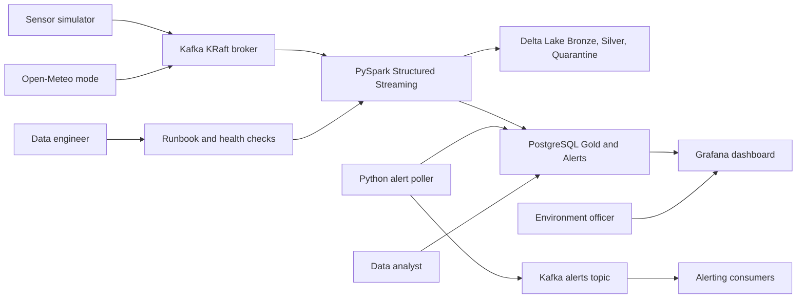
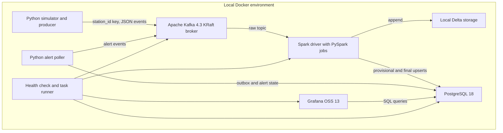
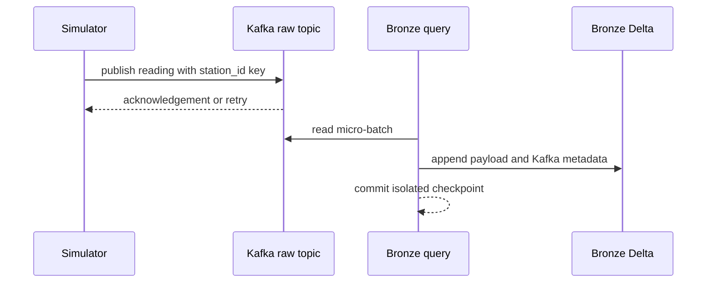
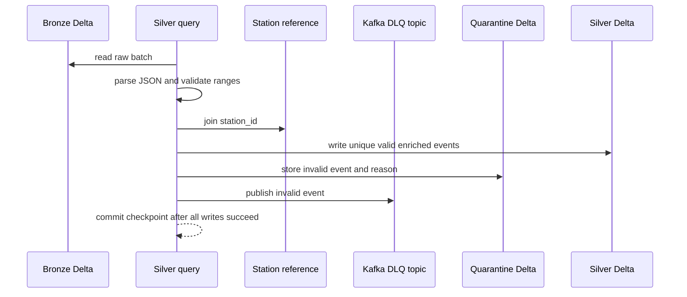
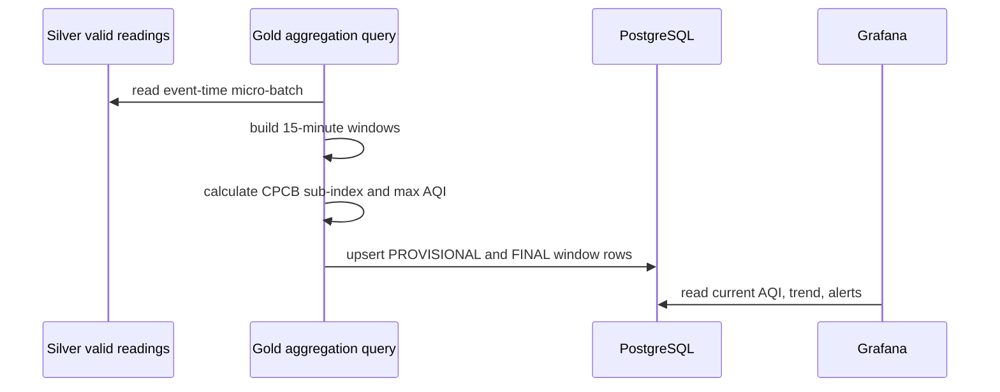
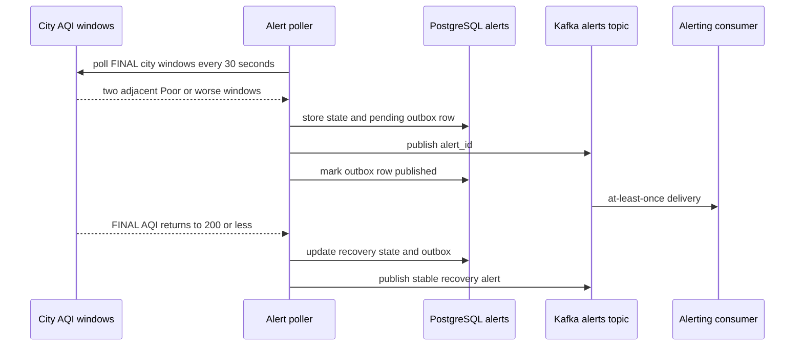
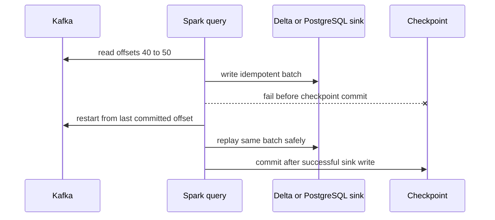

# System architecture

Purpose: This document explains the VayuStream architecture, main flows, local deployment, implementation repository shape, and required architecture decisions.

## Context diagram



The system runs locally. It uses simulated air-quality stations as the Must source. Open-Meteo is a Should source only.

## Container and component diagram



## Key sequence flows

### Simulator to Bronze



### Silver validation and quarantine



### Gold AQI and dashboard



### Alert and recovery flow



### Restart-safe replay



## Data-flow description

1. The simulator creates JSON readings for 10 lite stations in 5 cities.
2. The producer sends each parseable reading to `vayu.readings.raw` with key `station_id`.
3. Bronze stores every Kafka message with topic, partition, offset, key, timestamp, payload, and `ingest_date`.
4. Silver parses JSON, casts fields, validates ranges, joins station reference data, deduplicates by `event_id`, and applies a 15-minute watermark.
5. Invalid events go to both `vayu.readings.dlq` and `quarantine.invalid_readings`.
6. Valid late events are dropped from Silver and counted. They do not go to the DLQ.
7. Gold creates 15-minute station and city windows. It calculates completeness and indicative AQI.
8. Gold upserts PROVISIONAL rows in Update mode and FINAL rows in Append mode.
9. The alert poller reads FINAL city windows, writes outbox rows, and publishes at-least-once alert messages.
10. Grafana reads PostgreSQL only. It does not read directly from Kafka or Delta.

## Local deployment view

| Profile | Laptop | Services | Required limits |
|---|---|---|---|
| Lite | 8 GB RAM | Kafka, Spark local mode, PostgreSQL, Grafana, simulator | Kafka 768 MiB, Spark 2304 MiB, PostgreSQL 384 MiB, Grafana 192 MiB, simulator 128 MiB, Kafka UI disabled. |
| Standard | 16 GB RAM | Lite services plus Kafka UI and optional Mailpit | 50 sensors, 10 cities, Spark driver memory chosen by ADR, Kafka UI enabled. |

Windows users SHOULD use WSL2. For 8 GB laptops, set WSL memory to 4 GB and swap to 4 GB. For 16 GB laptops, set WSL memory to 8 GB and swap to 4 GB. The trainer MUST validate the lite profile on an 8 GB laptop before week 1.

## Expected student repository tree

```text
vayustream/
  README.md
  pyproject.toml
  uv.lock
  .env.example
  src/vayustream/
    simulator/
    producer/
    streaming/
    transforms/
    aqi/
    alerts/
    ops/
  config/
    stations/
    grafana/
    spark/
  data/
    delta/
    checkpoints/
  tests/
    unit/
    integration/
    e2e/
    fixtures/
  docs/
    adr/
    runbook.md
```

## Design principles

| Principle | VayuStream application |
|---|---|
| Medallion architecture | Bronze keeps raw audit data, Silver keeps trusted readings, and Gold serves dashboard tables. |
| Event-time processing | Watermarks and windows use `event_time`, not wall-clock arrival time. |
| Idempotent sinks | Delta and PostgreSQL use stable keys to survive replay. |
| At-least-once edges | Kafka and notifications can duplicate messages, so consumers deduplicate by stable IDs. |
| Pure transformations | Parsing, validation, AQI, and aggregation helpers support small batch DataFrame tests. |
| 12-factor configuration | Profiles, rates, paths, ports, and credentials come from environment variables. |
| Local-first operations | The lite stack runs on an 8 GB laptop without cloud services. |

## Required ADR topics

| ADR ID | Topic | Exact question the student MUST answer |
|---|---|---|
| ADR-001 | Spark and Delta version set | Which Spark, Delta Lake, Kafka connector, Scala, and Java versions are used, and why are they compatible? |
| ADR-002 | Checkpoint and replay strategy | How does each query choose checkpoint paths, and when is checkpoint deletion unsafe? |
| ADR-003 | PostgreSQL upsert design | Which business keys make station, city, and alert writes idempotent after replay? |
| ADR-004 | AQI interpretation | How does the project label 15-minute AQI as indicative while using CPCB breakpoints? |
| ADR-005 | Local hardware profile | Which services are disabled or limited in lite mode to fit 8 GB RAM? |
| ADR-006 | Optional real-data mode | If Open-Meteo is enabled, how are terms, units, polling rate, and failures handled? |
| ADR-007 | Optional schema evolution | If Avro or object storage is added, which maintained tool is selected and why? |

[Back to README](../README.md)
