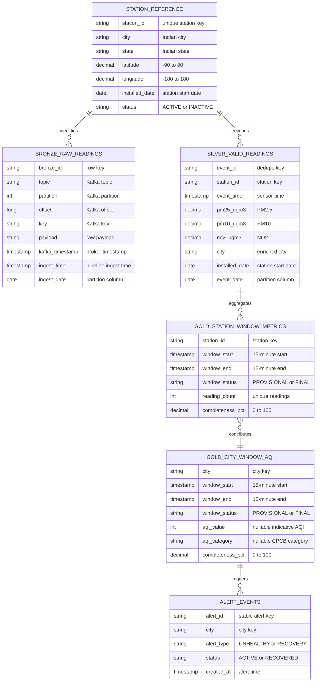

# Data model

Purpose: This document defines VayuStream data contracts, tables, keys, partitions, indexes, retention, and migration rules.

## Source datasets

| Source | Format | Licence or terms | Size in Must scope | Notes |
|---|---|---|---|---|
| Station reference | CSV | Student-created fictional data | 10 rows | Required columns: station ID, city, state, latitude, longitude, installed date. |
| Sensor simulator | JSON over Kafka | Student-created synthetic data | 10 sensors every 5 seconds | Must pollutants are PM2.5, PM10, and NO2. |
| Open-Meteo Air Quality API | HTTPS JSON | Free, no key, non-commercial use to be verified before use | 5 city polls per hour in Should scope | Publish with `source=open-meteo`. |

No source contains personal data.

## Data layers

| Layer | Storage | Purpose | Partitioning or key |
|---|---|---|---|
| Raw Kafka | Kafka topic `vayu.readings.raw` | Transport original station events. | Key is `station_id`; retention at least 7 days. |
| Bronze | Delta table `bronze.raw_readings` | Store raw Kafka messages and metadata. | Partition by `ingest_date`. |
| Silver | Delta table `silver.valid_readings` | Store typed, valid, unique, enriched readings. | Partition by `event_date`. |
| Quarantine | Delta table `quarantine.invalid_readings` | Store rejected events and reasons. | Partition by `ingest_date`. |
| DLQ Kafka | Kafka topic `vayu.readings.dlq` | Transport invalid events for debugging. | Key is station ID or `unknown`. |
| Gold station | PostgreSQL table `gold.station_window_metrics` | Store provisional and final 15-minute station metrics. | Key: `station_id`, `window_start`. |
| Gold city | PostgreSQL table `gold.city_window_aqi` | Store provisional and final 15-minute city metrics and indicative AQI. | Key: `city`, `window_start`. |
| Alert state | PostgreSQL tables `alerts.alert_events`, `alerts.poller_state`, and `alerts.outbox` | Store restartable cursor, streaks, cooldowns, and pending publications. | Alert key is `alert_id`; cooldown by city and category. |
| Alerts topic | Kafka topic `vayu.alerts` | Transport published alert events. | Key is `alert_id`; consumers de-duplicate. |

## Entity relationship diagram



## Event contract for `vayu.readings.raw`

| Field | Type | Required | Unit | Allowed values or range | Description |
|---|---|---|---|---|---|
| `schema_version` | string | Yes | none | `1.0` | Event schema version. |
| `event_id` | string | Yes | none | Stable opaque string, 12 to 80 characters | Idempotency and deduplication key. |
| `station_id` | string | Yes | none | Existing station reference ID | Kafka key and station join key. |
| `event_time` | string timestamp | Yes | UTC ISO-8601 | Not more than 24 hours in future | Sensor measurement time. |
| `ingest_time` | string timestamp | Yes | UTC ISO-8601 | Set before producer send | Producer ingest time. |
| `source` | string enum | Yes | none | `simulator`, `open-meteo` | Source system. |
| `profile` | string enum | Yes | none | `lite`, `standard`, `real-data` | Run profile. |
| `pm25_ugm3` | number | Yes | µg/m³ | 0 to 1000 | PM2.5 concentration. |
| `pm10_ugm3` | number | Yes | µg/m³ | 0 to 1000 | PM10 concentration. |
| `no2_ugm3` | number | Yes | µg/m³ | 0 to 1000 | NO2 concentration. |
| `so2_ugm3` | number | No | µg/m³ | 0 to 1000 | Standard profile pollutant. |
| `co_mgm3` | number | No | mg/m³ | 0 to 50 | Standard profile CO concentration. |
| `o3_ugm3` | number | No | µg/m³ | 0 to 1000 | Standard profile O3 concentration. |
| `nh3_ugm3` | number | No | µg/m³ | 0 to 2000 | Standard profile NH3 concentration. |
| `temperature_c` | number | No | °C | -20 to 60 | Standard profile ambient temperature. |
| `humidity_pct` | number | No | percent | 0 to 100 | Standard profile relative humidity. |
| `quality_flags` | array of strings | No | none | `duplicate`, `late`, `missing-field`, `out-of-range`, `malformed-source` | Simulator fault notes. |

```json
{
  "$schema": "https://json-schema.org/draft/2020-12/schema",
  "$id": "https://example.in/vayustream/schemas/reading-event-1.0.json",
  "title": "VayuStreamReadingEvent",
  "type": "object",
  "additionalProperties": false,
  "required": [
    "schema_version",
    "event_id",
    "station_id",
    "event_time",
    "ingest_time",
    "source",
    "profile",
    "pm25_ugm3",
    "pm10_ugm3",
    "no2_ugm3"
  ],
  "properties": {
    "schema_version": { "type": "string", "const": "1.0" },
    "event_id": { "type": "string", "minLength": 12, "maxLength": 80 },
    "station_id": { "type": "string", "pattern": "^[A-Z]{3}-[0-9]{3}$" },
    "event_time": { "type": "string", "format": "date-time" },
    "ingest_time": { "type": "string", "format": "date-time" },
    "source": { "type": "string", "enum": ["simulator", "open-meteo"] },
    "profile": { "type": "string", "enum": ["lite", "standard", "real-data"] },
    "pm25_ugm3": { "type": "number", "minimum": 0, "maximum": 1000 },
    "pm10_ugm3": { "type": "number", "minimum": 0, "maximum": 1000 },
    "no2_ugm3": { "type": "number", "minimum": 0, "maximum": 1000 },
    "so2_ugm3": { "type": "number", "minimum": 0, "maximum": 1000 },
    "co_mgm3": { "type": "number", "minimum": 0, "maximum": 50 },
    "o3_ugm3": { "type": "number", "minimum": 0, "maximum": 1000 },
    "nh3_ugm3": { "type": "number", "minimum": 0, "maximum": 2000 },
    "temperature_c": { "type": "number", "minimum": -20, "maximum": 60 },
    "humidity_pct": { "type": "number", "minimum": 0, "maximum": 100 },
    "quality_flags": {
      "type": "array",
      "items": {
        "type": "string",
        "enum": ["duplicate", "late", "missing-field", "out-of-range", "malformed-source"]
      },
      "uniqueItems": true
    }
  }
}
```

## Tables and columns

### `station_reference`

| Column | Logical type | Constraints | Description |
|---|---|---|---|
| `station_id` | string | Primary key; pattern `AAA-999` | Stable station identifier. |
| `city` | string | Required | Indian city name. |
| `state` | string | Required | Indian state or union territory. |
| `latitude` | decimal | Required; -90 to 90 | Station latitude. |
| `longitude` | decimal | Required; -180 to 180 | Station longitude. |
| `installed_date` | date | Required; not in future | Installation date. |
| `status` | enum | Required; `ACTIVE`, `INACTIVE` | Whether readings are expected. |

### `bronze.raw_readings`

| Column | Logical type | Constraints | Description |
|---|---|---|---|
| `bronze_id` | string | Required unique generated ID | Bronze row identifier. |
| `topic` | string | Required | Kafka topic name. |
| `partition` | integer | Required | Kafka partition. |
| `offset` | long | Required with topic and partition unique | Kafka offset. |
| `key` | string | Nullable | Kafka message key. |
| `payload` | string | Required | Raw Kafka payload. |
| `kafka_timestamp` | timestamp | Required | Kafka timestamp. |
| `ingest_time` | timestamp | Required | Bronze processing time. |
| `ingest_date` | date | Required partition | Date from `ingest_time`. |

### `silver.valid_readings`

| Column | Logical type | Constraints | Description |
|---|---|---|---|
| `event_id` | string | Primary dedupe key within watermark | Event identifier. |
| `station_id` | string | Required foreign key to station reference | Station identifier. |
| `event_time` | timestamp | Required | Measurement time. |
| `ingest_time` | timestamp | Required | Producer ingest time. |
| `source` | enum | Required | `simulator` or `open-meteo`. |
| `pm25_ugm3` | decimal | Required; 0 to 1000 | PM2.5 value. |
| `pm10_ugm3` | decimal | Required; 0 to 1000 | PM10 value. |
| `no2_ugm3` | decimal | Required; 0 to 1000 | NO2 value. |
| `city` | string | Required | Enriched city. |
| `state` | string | Required | Enriched state. |
| `latitude` | decimal | Required | Enriched latitude. |
| `longitude` | decimal | Required | Enriched longitude. |
| `installed_date` | date | Required | Enriched station installation date. |
| `event_date` | date | Required partition | Date from event time. |

### `quarantine.invalid_readings`

| Column | Logical type | Constraints | Description |
|---|---|---|---|
| `quarantine_id` | string | Primary key | Rejection row identifier. |
| `event_id` | string | Nullable | Parsed event ID if available. |
| `station_id` | string | Nullable | Parsed station ID if available. |
| `payload` | string | Required | Original payload. |
| `reason_code` | enum | Required | Validation reason. |
| `reason_detail` | string | Required | Human-readable detail. |
| `ingest_time` | timestamp | Required | Rejection time. |
| `ingest_date` | date | Required partition | Date from ingest time. |

### `gold.station_window_metrics`

| Column | Logical type | Constraints | Description |
|---|---|---|---|
| `station_id` | string | Primary key part 1 | Station identifier. |
| `window_start` | timestamp | Primary key part 2 | Inclusive 15-minute start. |
| `window_end` | timestamp | Required | Exclusive 15-minute end. |
| `window_status` | enum | Required; `PROVISIONAL` or `FINAL` | Whether the row is still updating or finalized by watermark. |
| `city` | string | Required | City at aggregation time. |
| `pm25_avg_ugm3` | decimal | Nullable | Average PM2.5. |
| `pm25_min_ugm3` | decimal | Nullable | Minimum PM2.5. |
| `pm25_max_ugm3` | decimal | Nullable | Maximum PM2.5. |
| `pm10_avg_ugm3` | decimal | Nullable | Average PM10. |
| `pm10_min_ugm3` | decimal | Nullable | Minimum PM10. |
| `pm10_max_ugm3` | decimal | Nullable | Maximum PM10. |
| `no2_avg_ugm3` | decimal | Nullable | Average NO2. |
| `no2_min_ugm3` | decimal | Nullable | Minimum NO2. |
| `no2_max_ugm3` | decimal | Nullable | Maximum NO2. |
| `reading_count` | integer | Required; 0 or more | Unique valid readings. |
| `expected_readings` | integer | Required; 180 in lite station window | Expected readings. |
| `completeness_pct` | decimal | Required; 0 to 100 | Completeness percentage. |
| `updated_at` | timestamp | Required | Last upsert time. |

### `gold.city_window_aqi`

| Column | Logical type | Constraints | Description |
|---|---|---|---|
| `city` | string | Primary key part 1 | City name. |
| `window_start` | timestamp | Primary key part 2 | Inclusive 15-minute start. |
| `window_end` | timestamp | Required | Exclusive 15-minute end. |
| `window_status` | enum | Required; `PROVISIONAL` or `FINAL` | Whether the row is still updating or finalized by watermark. |
| `active_sensor_count` | integer | Required | Active sensors in city. |
| `reading_count` | integer | Required | Unique valid city readings. |
| `expected_readings` | integer | Required | Expected readings for active sensors. |
| `completeness_pct` | decimal | Required; 0 to 100 | City completeness percentage. |
| `pm25_avg_ugm3` | decimal | Nullable | City PM2.5 average. |
| `pm25_min_ugm3` | decimal | Nullable | City PM2.5 minimum across station readings. |
| `pm25_max_ugm3` | decimal | Nullable | City PM2.5 maximum across station readings. |
| `pm10_avg_ugm3` | decimal | Nullable | City PM10 average. |
| `pm10_min_ugm3` | decimal | Nullable | City PM10 minimum across station readings. |
| `pm10_max_ugm3` | decimal | Nullable | City PM10 maximum across station readings. |
| `no2_avg_ugm3` | decimal | Nullable | City NO2 average. |
| `no2_min_ugm3` | decimal | Nullable | City NO2 minimum across station readings. |
| `no2_max_ugm3` | decimal | Nullable | City NO2 maximum across station readings. |
| `pm25_sub_index` | integer | Nullable | CPCB PM2.5 sub-index. |
| `pm10_sub_index` | integer | Nullable | CPCB PM10 sub-index. |
| `no2_sub_index` | integer | Nullable | CPCB NO2 sub-index. |
| `aqi_value` | integer | Nullable; 0 to 500 | Indicative AQI, null if insufficient. |
| `aqi_category` | enum | Nullable | CPCB category. |
| `aqi_basis` | string | Required | `15-minute indicative`. |
| `updated_at` | timestamp | Required | Last upsert time. |

### `alerts.alert_events`

| Column | Logical type | Constraints | Description |
|---|---|---|---|
| `alert_id` | string | Primary key | Stable alert identifier. |
| `city` | string | Required | City name. |
| `alert_type` | enum | Required | `UNHEALTHY` or `RECOVERY`. |
| `aqi_category` | enum | Required | CPCB category at alert time. |
| `aqi_value` | integer | Nullable | Indicative AQI value. |
| `trigger_window_start` | timestamp | Required | Window that triggered alert. |
| `trigger_window_end` | timestamp | Required | End of trigger window. |
| `status` | enum | Required | `ACTIVE`, `COOLDOWN`, `RECOVERED`. |
| `cooldown_until` | timestamp | Nullable | 60-minute cooldown end. |
| `created_at` | timestamp | Required | Alert creation time. |
| `updated_at` | timestamp | Required | Last status update. |

### `alerts.poller_state`

| Column | Logical type | Constraints | Description |
|---|---|---|---|
| `state_key` | string | Primary key | Cursor or city-category state name. |
| `last_window_end` | timestamp | Nullable | Last FINAL city window processed. |
| `streak_count` | integer | Required; 0 or more | Adjacent unhealthy windows seen. |
| `streak_category` | enum | Nullable | Category for the current streak. |
| `cooldown_until` | timestamp | Nullable | Current cooldown expiry. |
| `updated_at` | timestamp | Required | Last state update. |

### `alerts.outbox`

| Column | Logical type | Constraints | Description |
|---|---|---|---|
| `outbox_id` | string | Primary key | Pending publication row. |
| `alert_id` | string | Required | Stable alert event ID. |
| `payload` | string | Required | Alert JSON to publish. |
| `status` | enum | Required; `PENDING`, `PUBLISHED`, `FAILED` | Publication state. |
| `created_at` | timestamp | Required | Time the outbox row was created. |
| `published_at` | timestamp | Nullable | Time Kafka publish was confirmed. |

## Required indexes and constraints

| Object | Requirement |
|---|---|
| `bronze.raw_readings` | Delta invariant: one row per topic, partition, and offset through keyed idempotent writes. |
| `silver.valid_readings` | Deduplication by `event_id` with `dropDuplicatesWithinWatermark`; Delta replay uses keyed MERGE or idempotent `foreachBatch` options. |
| `quarantine.invalid_readings` | `reason_code` is required and indexed with `ingest_date`. |
| `gold.station_window_metrics` | Unique key on `station_id` and `window_start`; FINAL writes update the row status. |
| `gold.city_window_aqi` | Unique key on `city` and `window_start`; PROVISIONAL writes must not overwrite a FINAL row. |
| `alerts.alert_events` | Unique key on `alert_id`; index on `city`, `status`, and `created_at`. |
| `alerts.outbox` | Unique key on `outbox_id`; index pending rows by `status` and `created_at`. |
| `station_reference` | Unique key on `station_id`; active station count must match profile. |

## Enumerations

| Enum | Values |
|---|---|
| `source` | `simulator`, `open-meteo` |
| `profile` | `lite`, `standard`, `real-data` |
| `station_status` | `ACTIVE`, `INACTIVE` |
| `aqi_category` | `Good`, `Satisfactory`, `Moderate`, `Poor`, `Very Poor`, `Severe` |
| `alert_type` | `UNHEALTHY`, `RECOVERY` |
| `alert_status` | `ACTIVE`, `COOLDOWN`, `RECOVERED` |
| `window_status` | `PROVISIONAL`, `FINAL` |
| `reason_code` | `malformed-json`, `required-field-missing`, `pollutant-out-of-range`, `station-not-found`, `schema-version-unsupported`, `source-unsupported`, `event-id-invalid`, `event-time-invalid`, `ingest-time-invalid`, `profile-unsupported`, `quality-flag-unsupported` |

## Sample data

### Station reference rows

| station_id | city | state | latitude | longitude | installed_date | status |
|---|---|---|---:|---:|---|---|
| DEL-001 | Delhi | Delhi | 28.6139 | 77.2090 | 2026-01-10 | ACTIVE |
| MUM-001 | Mumbai | Maharashtra | 19.0760 | 72.8777 | 2026-01-12 | ACTIVE |
| BLR-001 | Bengaluru | Karnataka | 12.9716 | 77.5946 | 2026-01-15 | ACTIVE |

### Valid event example

```json
{
  "schema_version": "1.0",
  "event_id": "evt-20261002-del001-000001",
  "station_id": "DEL-001",
  "event_time": "2026-10-02T10:00:05Z",
  "ingest_time": "2026-10-02T10:00:06Z",
  "source": "simulator",
  "profile": "lite",
  "pm25_ugm3": 42.5,
  "pm10_ugm3": 88.2,
  "no2_ugm3": 34.0,
  "quality_flags": []
}
```

## Data retention

| Data | Retention |
|---|---|
| `vayu.readings.raw` | At least 7 days. |
| `vayu.readings.dlq` | At least 14 days. |
| `vayu.alerts` | At least 30 days. |
| Bronze Delta | Keep for the full 6-week project. |
| Silver Delta | Keep for the full 6-week project. |
| Quarantine | Keep for at least 30 days. |
| PostgreSQL gold and alerts | Keep for the full 6-week project. |

## Migration policy

Schema changes MUST increment `schema_version` for event contracts. Additive optional fields MAY be introduced in minor project changes. Required field changes MUST include migration notes and backward-compatibility tests. PostgreSQL changes MUST be described as migrations in the student repository, not as manual database edits.

## Data engineering rules

- Bronze is append-only and keeps malformed payloads.
- Silver is trusted, typed, enriched, and deduplicated.
- Gold PostgreSQL tables are serving tables for Grafana. `completeness_pct` is rounded to 2 decimals.
- AQI values are nullable when data is insufficient.
- Alert events are at-least-once externally but idempotent by `alert_id`.
- Quarantine IDs use Kafka topic, partition, and offset, so retries do not create duplicate rejection rows.
- No slowly changing dimensions are required for Must scope. If station metadata changes, the student MUST write an ADR for SCD Type 1 or Type 2.

[Back to README](../README.md)
