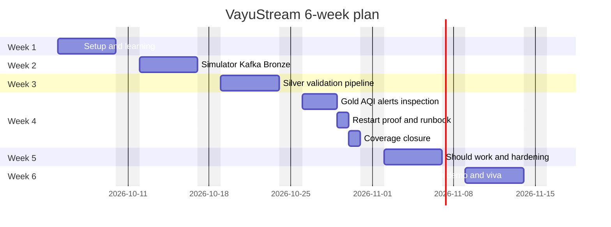

# Milestones and deliverables

Purpose: This document plans the 6-week VayuStream build, effort budget, demos, final submission, and demo script.

## Effort budget

The full project is about 180 hours. Must work is about 118 hours, including about 30 hours of learning and setup.
Feature tests are part of each feature estimate. The final Must proof line covers integration tests, CI gates, runbook evidence, and coverage closure.

Version 1.1 reallocates the six removed frontend hours to Python inspection contracts and local acceptance. Optional panel/map work becomes machine-readable summaries and replay evidence; no frontend/cloud task or related bonus path remains. Six weeks and the 118/180-hour totals are unchanged.

| Feature area | Linked IDs | Priority | Hours |
|---|---|---|---:|
| Learning and local setup | FR-OPS-02, NFR-PORT-01 | Must | 30 |
| Simulator and producer | FR-SIM-01, FR-SIM-02, FR-SIM-03 | Must | 12 |
| Kafka topics and replay basics | FR-KAF-01, FR-KAF-02 | Must | 8 |
| Bronze Delta ingestion | FR-BRZ-01 | Must | 8 |
| Silver validation, DLQ, watermark, enrichment | FR-SLV-01, FR-SLV-02, FR-SLV-03, FR-SLV-04 | Must | 20 |
| Gold windows and AQI | FR-GLD-01, FR-AQI-01, FR-GLD-02 | Must | 16 |
| Alerts and recovery | FR-ALT-01, FR-ALT-02 | Must | 8 |
| Python inspection formats and local acceptance | FR-CLI-01, FR-OPS-02 | Must | 6 |
| Restart safety, runbook, and coverage closure | FR-OPS-01, FR-OPS-03, FR-TEST-01 | Must | 10 |
| **Must subtotal** |  |  | **118** |
| Should features | FR-REAL-01, FR-CLI-02, FR-DAILY-01, FR-MAINT-01 | Should | 32 |
| Hardening, interview prep, contingency | All Must and Should | Should | 30 |
| **Total** |  |  | **180** |

## Week-by-week plan

| Week | Goals | Tasks with FR IDs | Deliverables | Friday demo checkpoint |
|---|---|---|---|---|
| 1 | Understand streaming basics and start the repo. | Set up WSL2 or local tools for FR-OPS-02; create repo skeleton; write ADR drafts; start CI for FR-TEST-01; define station CSV for FR-SIM-01. | Clean clone setup, first PR, CI skeleton, station reference. | Show environment, branch workflow, and one health check. |
| 2 | Publish and preserve raw events. | Build simulator for FR-SIM-01; add deterministic faults for FR-SIM-02; implement producer shutdown for FR-SIM-03; create Kafka topics for FR-KAF-01; write Bronze for FR-BRZ-01. | Raw topic, Bronze table, simulator tests. | Show 10 sensors publishing and Bronze row counts. |
| 3 | Build trusted Silver data. | Parse and validate for FR-SLV-01; write DLQ and quarantine for FR-SLV-02; dedupe and watermark for FR-SLV-03; enrich stations for FR-SLV-04. | Silver table, quarantine table, DLQ messages, validation tests. | Show deterministic 100-message outcomes and explain late drops. |
| 4 | Finish Must data product and local proof. | Compute windows/AQI for FR-GLD-01 and FR-AQI-01; upsert PostgreSQL for FR-GLD-02; alert/recover for FR-ALT-01/02; implement JSON/text/CSV inspection for FR-CLI-01; finish offline/start-stop/error tests for FR-OPS-02 and restart/runbook/coverage for FR-OPS-01/03 and FR-TEST-01. | Must pipeline, four-command snapshots, TC-LOCAL-001 through TC-LOCAL-004, AQI/recovery tests, runbook, coverage report. | Show indicative AQI CLI output, stable alert/outbox evidence, and persisted restart/replay without duplicate keys. |
| 5 | Add Should items and harden. | Optionally add FR-REAL-01, FR-CLI-02, FR-DAILY-01, or FR-MAINT-01; fix edge cases found in week 4 proof. | Should demo if ready, hardening PRs, updated ADRs. | Show one Should item or a hardened failure path. |
| 6 | Polish portfolio and prepare viva. | Finalize README, ADRs, CHANGELOG, and demo video; rehearse Kafka, Spark, AQI, and SQL explanations. | Final tag, release notes, demo video, viva notes. | Final 10-minute demo rehearsal. |

## Gantt chart

## Final deliverables checklist

- Public GitHub repository named `vayustream`.
- Trainer `@sukurcf` added as collaborator.
- README with doc 06 start/stop/confirmed-reset commands, loopback ports, cached-runtime prerequisites, and offline demo in 10 setup steps or fewer.
- Architecture diagram and at least 5 ADRs in the student repository.
- Working lite profile with 10 stations, one Kafka broker, one shared Spark driver/SparkSession for six queries, and no UI services.
- Kafka topics `vayu.readings.raw`, `vayu.readings.dlq`, and `vayu.alerts`.
- Bronze, Silver, Quarantine, Gold, and Alerts stores.
- Python current/windows/completeness/alerts commands with exact JSON/text/CSV examples, null AQI, and PROVISIONAL/FINAL labels.
- Runbook for local start/stop/reset, offline demo, inspection, restart, offset replay, and Bronze-to-Silver reprocessing; consoles optional operations only.
- Test report showing at least 45 meaningful cases, inspection snapshots, and TC-LOCAL-001 through TC-LOCAL-004.
- Coverage report showing 80% line, 70% branch, and 100% AQI branch coverage.
- CI green on `main`.
- CHANGELOG and final tag `v1.0.0`.
- Demo video of maximum 5 minutes.

## Submission process

1. Freeze Must scope after week 4 unless the trainer approves a fix.
2. Push all work to `main` through reviewed pull requests.
3. Run full CI and the offline lite acceptance suite; capture persistence/failure evidence and actual RAM usage against proposed budgets.
4. Create tag `v1.0.0` after CI is green.
5. Create a GitHub Release with the demo video link and coverage report.
6. Open a final submission issue in the specification repository.
7. Include repository link, release link, demo video link, and known limitations.
8. Be ready to run the lite profile live during the viva.

## 10-minute demo script

| Minute | What to show | Key points to say |
|---:|---|---|
| 0-1 | Repository, README, and CI badge | Explain the goal and show green `main`. |
| 1-2 | Doc 06 start/health and loopback bindings | State proposed lite budgets: 1 broker, 1 shared Spark driver, 2048 MiB including Python workers/1280m heap, 10 stations, no UI services. Do not claim unmeasured RAM. |
| 2-3 | Simulator output and raw topic | Explain station key, event ID, event time, ingest time, and faults. |
| 3-4 | Bronze and Silver data | Show raw audit rows, valid rows, quarantine reasons, and DLQ count. |
| 4-5 | Watermark and dedupe test | Explain 5 extra duplicate copies and 2 late drops from the 100-message test. |
| 5-6 | Gold city AQI | Explain 15-minute windows, completeness, CPCB sub-index, and null AQI rules. |
| 6-7 | PostgreSQL upsert and restart test | Show no duplicate city or station window keys after replay. |
| 7-8 | Alerts | Show Poor for 2 consecutive windows, 60-minute cooldown, and recovery at AQI 200. |
| 8-9 | Four-command Python inspection | Show current AQI, recent windows, station/city completeness, and alerts as JSON/text/CSV; distinguish FINAL/PROVISIONAL and null AQI. |
| 9-10 | Local reliability, tests, and runbook | Show TC-LOCAL evidence for offline `100/87/6/6` counts, persisted stop/start and clear errors, coverage/AQI gates, and one technical lesson. |

## Friday demo expectations

Every Friday demo is 15 minutes. The student MUST show one working increment, one test result, and one issue or ADR. The trainer MAY ask the student to change a small value live. The student MUST explain the code before changing it.

[Back to README](../README.md)
